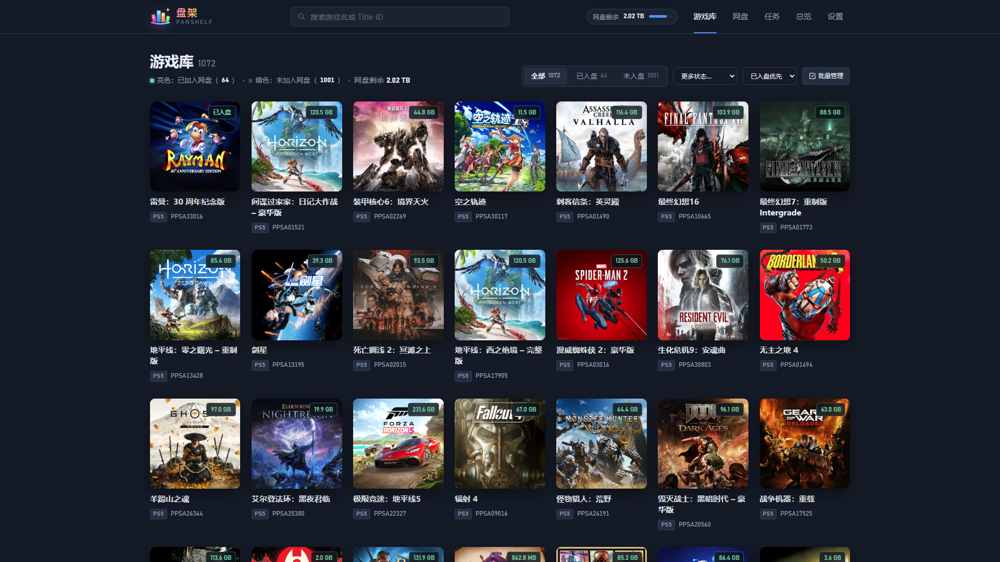

# 盘架 PanShelf

给用百度网盘存 PS5 / PS4 游戏的人用的游戏库管理器。

网盘装不下所有游戏？盘架把资源站上的游戏同步成一个带封面的本地游戏库，只记录链接、不占网盘空间。想玩哪个点「加入网盘」自动转存，玩完点「退出网盘」删掉腾地方，以后随时再加回来。

- 自动采集：采集哪个网站、哪些分类由你自己配置，每天定时抓新帖
- 一游戏一版本：同一游戏有多个版本时只留一个（exFAT 优先），目录统一整理成 `PPSAxxxxx` / `CUSAxxxxx`
- 空间可控：剩余空间低于 200 GB 自动停止转存；删除前列出文件和大小，确认后才执行，删掉的文件进网盘回收站



## 安装

**方式一：Node.js**（需要 22.13 或以上）

```bash
npm run setup
npm start
```

**方式二：Docker**

```bash
docker compose up -d --build
```

启动后打开 http://127.0.0.1:5175 。

## 首次设置

进「设置」页按顺序完成：

1. 用百度网盘 App 扫码登录
2. 添加采集来源：填写站点地址和分类路径
3. 设置游戏转存到网盘的哪个目录

然后到「总览」点「立即运行一轮」。首次会抓取整个分类，可能要一段时间，中断后下次会接着抓。

## 日常使用

- **游戏库**：搜游戏，点「加入网盘」或「退出网盘」
- **任务**：看转存进度，可暂停、继续、取消
- **网盘**：看空间占用，一键整理目录（先预览再执行）

默认只采集链接、不自动转存。想采到就存，去「设置 → 转存策略」打开自动转存。

Windows 开机自启：

```powershell
powershell -ExecutionPolicy Bypass -File scripts\install-autostart.ps1
```

## 注意

- 控制台没有登录验证，默认只监听本机。要从外网访问，请在反向代理上加认证。
- 数据库和网盘登录凭据：Node 方式保存在项目下的 `state/` 和 `bduss.txt`，Docker 方式保存在 `./data`（重建容器不会丢失）。
