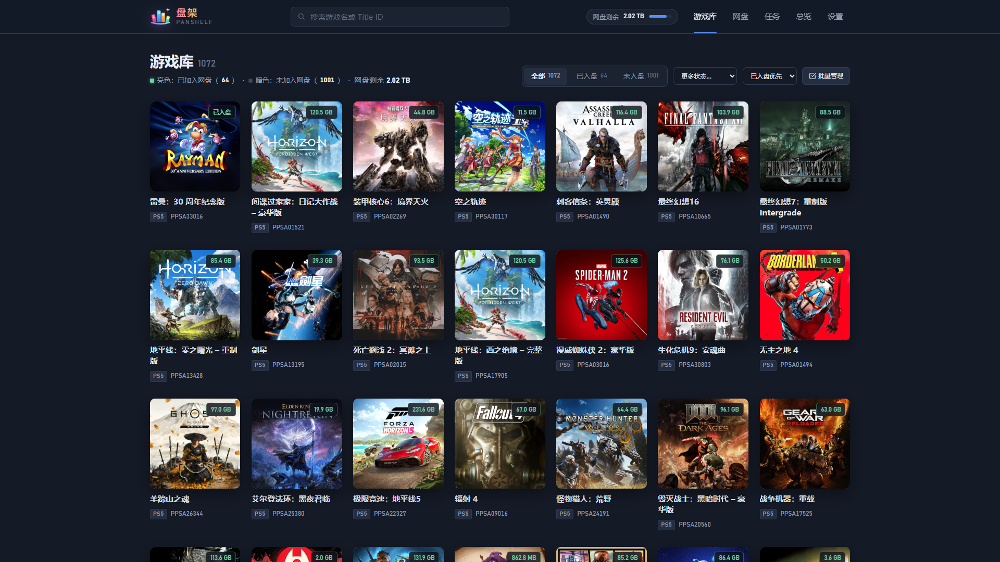

# 盘架 PanShelf

给用百度网盘存 PS5 / PS4 游戏的人用的游戏库管理器。

网盘装不下所有游戏？盘架把资源站上的游戏同步成一个带封面的本地游戏库，只记录链接、不占网盘空间，并把整份清单发布到网盘的 `/盘游/资源库.json`。[盘游](https://github.com/cnwinds/pan-play) 读到后直接列出全部游戏，点安装时自己转存进网盘、空间不够时自己把能再转回来的游戏移出网盘。所以盘架一般开着不用管；想手动管网盘，游戏库里照样能「加入网盘」「退出网盘」。

- 自动采集：采集哪个网站、哪些分类由你自己配置，每天定时抓新帖
- 链接检查：每条链接 7 天列一次分享，记下还能不能用、多大，失效的盘游里会标出来、也不会被盘游移出网盘（移出后就转不回来了）
- 安装编排：在「设置 › 大模型分析」填一个 OpenAI 兼容接口（DeepSeek、通义千问、OpenAI、本地 Ollama 都行）后，盘架把每个游戏分享里的文件清单和说明文件交给大模型，排出主游戏、补丁的叠放顺序和要放进游戏目录的文件，写进资源库，盘游照着装；说明文件临时转存到网盘的 `/盘架临时`，读完就删。盘游发现对不上、装失败、标了有问题，会写到网盘的 `/盘游/反馈`，盘架读到后带着问题重新分析
- 按格式收录：同一游戏的 exFAT、文件夹、未标注三种格式各留版本最高的一个（PKG 不收），加入网盘时可以选要哪几种（默认全选）
- 目录规范：每个游戏一个 `PPSAxxxxx` / `CUSAxxxxx` 目录，每种格式放进其中的 `@exfat`、`@folder`、`@other` 子目录，[盘游](https://github.com/cnwinds/pan-play) 据此让你选装哪种格式；旧的没分格式的目录，「网盘 → 目录规整」能按转存记录挪进去
- 空间可控：剩余空间低于 200 GB 自动停止转存；删除前列出文件和大小，确认后才执行，删掉的文件进网盘回收站



## 安装

**方式一：Node.js**（需要 22.13 或以上）

```bash
npm run setup
npm start
```

**方式二：Docker**

```bash
docker compose up -d --build
npm install --prefix web   # 挂载 web/dist 后需在宿主机能构建前端
npm run build
docker compose up -d       # 应用 compose 里的代码挂载（无需再 build 镜像）
```

启动后打开 http://127.0.0.1:5175 。

**Docker 日常更新**（改前端/后端代码时，不必重建镜像；项目根目录与 `web/` 下的 `.npmrc` 已指向 [npmmirror](https://npmmirror.com)）：

```bash
./scripts/update-docker.sh
# 或：npm run update:docker
```

仅当 `package.json` 依赖变更时才需要 `docker compose up -d --build`。

## 首次设置

进「设置」页按顺序完成：

1. 用百度网盘 App 扫码登录
2. 添加采集来源：填写站点地址和分类路径
3. 设置游戏转存到网盘的哪个目录

然后到「总览」点「立即运行一轮」。首次会抓取整个分类，可能要一段时间，中断后下次会接着抓。

## 日常使用

- **游戏库**：搜游戏，点「加入网盘」或「退出网盘」
- **任务**：看转存进度，可暂停、继续、取消
- **网盘**：看空间占用，一键整理目录（先预览再执行）；「盘游资源库」一栏显示发布了多少游戏、链接查了多少、失效多少，也可以立即发布或检查链接

默认只采集链接、不自动转存，网盘里放哪些游戏交给盘游按需决定。想采到就存，去「设置 → 转存策略」打开自动转存。

盘游转存时放到它设置里的游戏库目录下，要和这里的转存目录填同一个，不然两边看不到对方转存的游戏（不一样时盘游设置页会直接填成这里的转存目录）。

用 [盘游](https://github.com/cnwinds/pan-play) 装游戏时标过「能玩 / 有问题」的，盘架会从网盘的 `/盘游/评价` 读过来：游戏库格子上显示评价，「更多状态筛选 → 盘游评过」能列出来。分享里的文件和标了有问题的那份完全一样时，自动转存会跳过，手动加入会先提醒（可以仍然加入）；网盘页会列出网盘里还占着空间的这类游戏，可以一键退出网盘。评错了可以在游戏详情的「盘游评价」里点笔改成能玩 / 不能玩、改说明，或点垃圾桶删掉：盘架把改动写到网盘的 `/盘游/评价/<盘架>.json`，时间比原来的晚，各台盘游下次同步（10 分钟内）就跟着变。

Windows 开机自启：

```powershell
powershell -ExecutionPolicy Bypass -File scripts\install-autostart.ps1
```

## 注意

- 控制台没有登录验证，默认只监听本机。要从外网访问，请在反向代理上加认证。
- 数据库和网盘登录凭据：Node 方式保存在项目下的 `state/` 和 `bduss.txt`，Docker 方式保存在 `./data`（重建容器不会丢失）。
